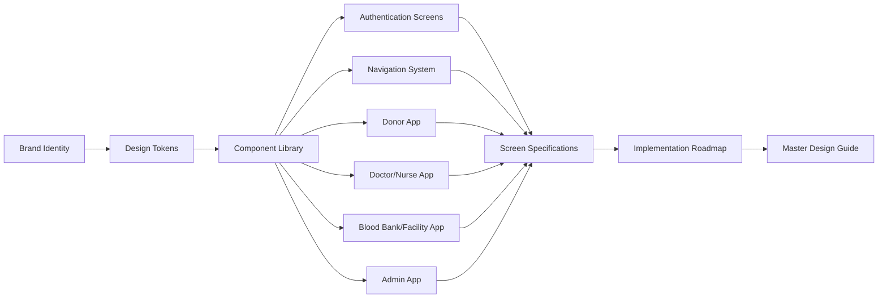

# Requirements

## Overview & Goals

This task produces a comprehensive **UI/UX Design System and Implementation Design Guide** for the HEMORA mobile application — an AI-powered Blood Forecasting and Donor Mobilisation system for the Zambian healthcare environment. The output is **design documentation only**: no source code, database schemas, API contracts, or authentication logic will be modified.

The goal is to create a single source of truth for all future HEMORA mobile UI implementation, covering brand identity, design tokens, authentication, role-based dashboards, navigation, reusable components, and screen-by-screen specifications.

## Scope

### In Scope
- **Phase 0**: Complete project audit of the existing hemora-mobile Expo React Native app
- **Phase 1**: Brand identity and design token documentation
- **Phase 2**: Complete authentication screen design (welcome, login, registration, staff invitation, forgot/reset password, email verification, Google sign-in, all states)
- **Phase 3**: Global navigation architecture (bottom nav, drawer, headers, screen layouts)
- **Phase 4**: Donor application design (11 screens)
- **Phase 5**: Doctor and Nurse application design (~14 screens)
- **Phase 6**: Blood Bank Manager and Healthcare Facility design (~17 screens)
- **Phase 7**: System Administrator design (9 screens)
- **Phase 8**: Reusable component library documentation
- **Phase 9**: Screen-by-screen specifications for all ~60+ screens
- **Phase 10**: Implementation roadmap and final quality review

### Out of Scope
- Modifying application source code
- Changing database schemas or API contracts
- Implementing authentication logic changes
- Creating actual image/SVG logo assets (design direction only)
- Desktop web layouts
- Dark theme implementation (light theme only per requirements)

## User Stories

- As a **Blood Donor**, I want a clean, trustworthy dashboard so I can see my eligibility, campaign invitations, and donation history at a glance.
- As a **Doctor**, I want to create and track blood requests for patients so I can ensure timely blood availability.
- As a **Nurse**, I want to coordinate donation workflows and screen donors so I can manage the donation process efficiently.
- As a **Blood Bank Manager**, I want to monitor inventory, manage requisitions, and run campaigns so I can maintain adequate blood supply.
- As a **Healthcare Facility Admin**, I want to request blood and coordinate with staff so I can serve patients effectively.
- As a **System Administrator**, I want a national overview and user management so I can oversee the entire HEMORA platform.

## Functional Requirements

1. **One common login** — no role selection during login
2. **Donor accounts** — public registration with blood group selection
3. **Staff accounts** — created through authorised invitation or admin provisioning only
4. **Google sign-in** — follows official Google branding guidelines, donor-only
5. **Role-based dashboards** — content and permissions differ, visual language is consistent
6. **Consistent design system** — all screens belong to the same HEMORA product
7. **Mobile-first** — Android and iOS prioritized, safe areas, touch targets, keyboard handling
8. **Meaningful status indicators** — never rely on colour alone
9. **Complete screen states** — loading, empty, error, success, disabled, offline

## Non-Functional Requirements

- **Accessibility**: WCAG 2.1 AA contrast ratios, minimum 44x44 touch targets, screen reader labels, reduced motion support
- **Visual Consistency**: All roles share the same burgundy healthcare identity, white backgrounds, clean cards, consistent typography
- **Trustworthiness**: Professional healthcare appearance, not a generic admin template
- **Scalability**: Reusable components and centralized design tokens
- **Usability**: Clear information hierarchy, appropriate whitespace, consistent navigation


# Technical Design

## Current Implementation

### Project Structure
The HEMORA mobile app is an **Expo React Native** project (~55.0.32) using **expo-router** for file-based routing.

```
hemora-mobile/
├── src/
│   ├── app/
│   │   ├── _layout.tsx          # Root layout: session guard, Stack navigator
│   │   ├── (auth)/              # Auth group: sign-in, sign-up, forgot-password
│   │   └── (main)/              # Main group: home (role router), dashboards
│   │       ├── home.tsx         # Routes to role-specific dashboard
│   │       └── _dashboard/      # 6 role dashboards
│   │           ├── donor.tsx
│   │           ├── doctor.tsx
│   │           ├── nurse.tsx
│   │           ├── bank-manager.tsx
│   │           ├── facility-admin.tsx
│   │           └── admin.tsx
│   ├── components/
│   │   ├── ui/                  # Button, Input, PasswordInput, SearchInput,
│   │   │                        # Dropdown, DatePicker, Modal, Card, Badge,
│   │   │                        # Icon, StatCard, EmptyState, Animations
│   │   ├── navigation/          # BottomNavigation, SideDrawer, ScreenHeader
│   │   └── feedback/            # Toast, ErrorState, ConfirmationDialog, Skeleton
│   ├── constants/
│   │   └── theme.ts             # Colors (light/dark), Typography, Spacing,
│   │                             # Radius, Shadows
│   ├── lib/
│   │   ├── auth-client.ts       # better-auth client, SecureStore session caching
│   │   ├── api.ts               # hemoraFetch utility
│   │   └── permissions.ts       # Role definitions and access control
│   └── global.css               # Font family CSS variables
├── assets/                      # Default Expo assets, no HEMORA branding
└── package.json                 # Dependencies listed below
```

### Technology Stack
- **Framework**: Expo React Native ~55.0.32
- **Routing**: expo-router ~55.0.18 (file-based)
- **Navigation**: @react-navigation/bottom-tabs, @react-navigation/drawer, @react-navigation/native
- **Authentication**: better-auth ~1.7.25 with @better-auth/expo, SecureStore
- **State Management**: @tanstack/react-query ~5.108.0
- **Forms**: react-hook-form ~7.92.0, zod ~4.6.7
- **Icons**: lucide-react-native ~1.75.0
- **Animations**: react-native-reanimated 4.2.1
- **UI**: react-native-safe-area-context, react-native-screens
- **Language**: TypeScript ~5.9.2

### Existing Design Tokens (theme.ts)
- **Colours**: Primary #A71930, Dark Burgundy #801629, Muted Rose #C66B79, Background #F7F8FA, Surface #FFFFFF, Text #202735, Secondary Text #667085, Border #E5E7EB, Success #36836B, Warning #C58A35, Danger #A71930, Info #3B82F6
- **Typography**: h1(28/36/700), h2(22/30/600), h3(18/26/600), h4(17/24/600), body(16/24/400), bodySmall(14/20/400), caption(12/16/400), button(16/24/600), overline(11/16/600 tracked)
- **Spacing**: 4px grid (2, 4, 8, 12, 16, 20, 24, 32, 40, 64)
- **Radius**: none(0), sm(4), md(8), lg(12), xl(16), 2xl(24), full(9999)
- **Shadows**: sm, md, lg with cross-platform elevation

### Existing User Roles
ADMIN, BANK_MANAGER, FACILITY_ADMIN, DOCTOR, NURSE, DONOR — defined in `src/lib/permissions.ts` and routed via `home.tsx`.

### Existing Screens
- **Auth**: sign-in (email/password), sign-up (donor with blood group), forgot-password
- **Main**: home (role router), 6 role dashboards with API integration
- **Missing**: Welcome screen, staff invitation onboarding, email verification, reset password, Google sign-in, campaign screens, donation history screens, profile screens, settings screens, help screens

### Existing Components
- **UI**: Button (5 variants, 3 sizes), Input, PasswordInput, SearchInput, Dropdown, DatePicker, Modal, Card, Badge (6 variants), Icon/IconButton, StatCard, EmptyState, Animations (4 components)
- **Navigation**: BottomNavigation (with badges), SideDrawer (with profile header)
- **Feedback**: Toast, ErrorState, ConfirmationDialog, Skeleton

### Design Inconsistencies Identified
1. No HEMORA logo or branding assets — screens use text badges ("ZNBTS • HEMORA PROTOTYPE")
2. No welcome/get-started screen
3. No Google sign-in implementation
4. No staff invitation onboarding flow
5. No email verification flow
6. Bottom navigation and drawer components exist but are not integrated into any dashboard
7. No safe-area handling in dashboards
8. Inconsistent footer text across dashboards
9. No campaign detail, donation history, profile, settings, or help screens
10. All dashboards use inline StyleSheet rather than shared layout components

## Key Decisions

1. **Documentation-only approach**: All output will be Markdown files in `docs/design-system/`. No source code modifications.
2. **Extend existing design tokens**: The existing colour palette and typography in `theme.ts` align with the reference design. The documentation will formalize and extend these tokens rather than replacing them.
3. **One design system for all roles**: All screens share the same burgundy healthcare identity. Content and permissions differ by role, but visual language is consistent.
4. **Reference images as primary direction**: The supplied HEMORA reference images establish the visual language. The documentation extends this language across all screens.
5. **Component library maps to existing code**: The component documentation will reference existing components in `src/components/ui/` and document what's missing.
6. **Mobile-first, light theme only**: Per requirements, focus on Android and iOS with light theme.
7. **Inter/Spline Sans typography**: The existing CSS variables already reference Spline Sans and Inter. This will be formalized.

## Proposed Changes

### Deliverables (11 documentation files)
All files will be created in `docs/design-system/`:

1. `PHASE-00-PROJECT-AUDIT.md` — Complete project inspection report
2. `DESIGN-TOKENS.md` — Colours, typography, spacing, borders, shadows, icons, dimensions
3. `BRAND-IDENTITY.md` — Brand name, tagline, logo direction, visual language, accessibility
4. `AUTHENTICATION-DESIGN.md` — All auth screens, flows, states, rules (with Mermaid diagrams)
5. `NAVIGATION-ARCHITECTURE.md` — Bottom nav, drawer, headers, layouts, role-based nav (with Mermaid diagrams)
6. `DONOR-APPLICATION-DESIGN.md` — All donor screens with specifications
7. `DOCTOR-NURSE-DESIGN.md` — Doctor and Nurse screens with specifications
8. `BLOOD-BANK-FACILITY-DESIGN.md` — Blood Bank Manager and Facility screens
9. `ADMIN-DASHBOARD-DESIGN.md` — System Administrator screens
10. `COMPONENT-LIBRARY.md` — Reusable component system with variants, states, properties
11. `SCREEN-BY-SCREEN-SPECIFICATIONS.md` — Consolidated screen reference for all ~60+ screens
12. `DESIGN-IMPLEMENTATION-ROADMAP.md` — Implementation phases, dependencies, testing, QA
13. `HEMORA-UI-UX-DESIGN-GUIDE.md` — Master design guide combining all documentation

### Architecture Diagram



### Risks
- **Reference images not accessible**: The design references are mentioned but not embedded in the codebase. The documentation will be based on the colour palette and patterns already established in the existing code.
- **Scope complexity**: ~60+ screens across 6 roles with complete state documentation is a large documentation effort. Each phase will be reviewed independently.
- **Component gap analysis**: Some required components (e.g., CampaignCard, DonationCard, BloodGroupCard) don't exist yet and will be documented as new components.
- **Backend API assumptions**: Screen designs reference existing API endpoints. New screens may require new endpoints that don't exist yet — these will be noted but not invented.

# Delivery Steps

### ✓ Step 1: Phase 0 — Project Audit Document
Create PHASE-00-PROJECT-AUDIT.md documenting the complete inspection of the existing HEMORA mobile project.

- Document technology stack: Expo React Native ~55, expo-router, better-auth, @tanstack/react-query, lucide-react-native, react-native-reanimated, zod, react-hook-form
- Document folder structure: src/app/(auth) for auth screens, src/app/(main) for role-based dashboards, src/components/ui for reusable components, src/components/navigation for navigation, src/components/feedback for feedback UI, src/constants/theme.ts for design tokens, src/lib for auth and API utilities
- Document existing screens: sign-in.tsx, sign-up.tsx, forgot-password.tsx, home.tsx (role router), and 6 role dashboards (donor, doctor, nurse, bank-manager, facility-admin, admin)
- Document existing UI components: Button (5 variants, 3 sizes), Input, PasswordInput, SearchInput, Dropdown, DatePicker, Modal, Card, Badge, Icon/IconButton, StatCard, EmptyState, animations (AnimatedPressable, FadeInView, SlideInView, AnimatedCard, StaggerChildren)
- Document navigation components: BottomNavigation (with badges), SideDrawer (with profile header, nav items, footer)
- Document design tokens in theme.ts: Colors (light/dark), Typography (h1–h4, body, caption, button, overline), Spacing (4px grid), Radius, Shadows
- Document authentication architecture: better-auth with expo-client plugin, SecureStore session caching, role-based routing via home.tsx → dashboard screens
- Document user roles: ADMIN, BANK_MANAGER, FACILITY_ADMIN, DOCTOR, NURSE, DONOR
- Document existing design inconsistencies: no logo/branding assets (uses text badges), no welcome screen, no Google sign-in, no staff invitation onboarding, no email verification, no bottom navigation or drawer integrated into dashboards, no safe-area handling in dashboards, inconsistent footer text across dashboards
- Document assets directory: default Expo assets only, no HEMORA branding assets
- Identify gaps vs requirements: missing screens (welcome, staff invitation, email verification, reset password), missing navigation integration, missing branding, missing component variants

### ✓ Step 2: Phase 1 — Brand Identity and Design Tokens
Create DESIGN-TOKENS.md and BRAND-IDENTITY.md establishing the complete HEMORA visual identity.

- Define complete colour palette with primary burgundy #A71930, dark burgundy #801629, secondary rose #C66B79, light rose #F8E8EB, and full semantic colours (background, surface, text hierarchy, status colours with light variants for badges)
- Define typography scale using Inter/Spline Sans: display (32/40), h1 (28/36), h2 (22/30), h3 (18/26), h4 (17/24), body (16/24), bodySmall (14/20), caption (12/16), button (16/24 semi-bold), overline (11/16 bold tracked), numeric stats (24/32 bold)
- Define spacing scale: 2, 4, 8, 12, 16, 20, 24, 32, 40, 64 with semantic keys (xs–4xl)
- Define border radii: none(0), sm(4), md(8), lg(12), xl(16), 2xl(24), full(9999)
- Define shadow presets: sm, md, lg with cross-platform elevation
- Define iconography: lucide-react-native as primary icon library, sizes (12, 16, 18, 20, 22, 24, 28, 32, 48)
- Define component dimensions: input height 48, button heights (lg 48, md 40, sm 32), card padding 16, card radius 12
- Define design tokens for HEMORA blood-drop symbol usage and logo variations
- Establish accessibility standards: WCAG 2.1 AA contrast ratios, minimum 44x44 touch targets, reduced motion support, screen reader labels
- Define brand identity: HEMORA name, tagline 'Connecting donors. Saving lives.', blood-drop + medical cross symbol, brand voice and tone

### ✓ Step 3: Phase 2 — Authentication Design Documentation
Create AUTHENTICATION-DESIGN.md with complete specifications for all auth screens and flows.

- Welcome/Get Started screen: full-bleed burgundy hero, HEMORA logo with blood-drop symbol, tagline, 'Get Started' CTA, 'Already have an account? Sign In' link
- Common Login screen: logo header, email and password inputs with icons, password visibility toggle, 'Forgot password?' link, primary 'Sign In' button, Google sign-in with official branding, 'New blood donor? Register here' link
- Donor Registration screen: name, email, password fields, blood group selection grid (8 groups with +/- display), 'Register as Donor' CTA, 'Already registered? Sign In' link
- Staff Invitation Onboarding screen: invitation code verification, name, email, password setup, role display badge, 'Complete Setup' CTA
- Forgot Password screen: email input, 'Send Reset Link' CTA, 'Back to Sign In' link
- Reset Password screen: new password, confirm password, 'Reset Password' CTA
- Email Verification screen: verification code input, 'Verify Email' CTA, 'Resend Code' link
- Authentication loading, error, and success states with consistent styling
- Google sign-in integration following official Google branding guidelines
- Complete navigation flow diagram (Mermaid) showing all auth transitions
- Role-based authentication rules: donors register publicly, staff via invitation only, no role selection during login
- Form validation rules, keyboard handling, and password visibility controls
- Screen layouts with component placement, spacing, and typography specifications

### ✓ Step 4: Phase 3 — Navigation Architecture Documentation
Create NAVIGATION-ARCHITECTURE.md with complete navigation system design.

- Bottom navigation design: max 4–5 tabs per role, burgundy active state, muted inactive, icon + label, badge support for notifications
- Donor bottom nav: Home, Campaigns, Donations, Profile
- Doctor bottom nav: Home, Requests, Availability, Profile
- Nurse bottom nav: Home, Screening, Records, Profile
- Bank Manager bottom nav: Home, Inventory, Requests, Campaigns, Profile
- Facility bottom nav: Home, Requests, Staff, Profile
- Admin bottom nav: Home, Users, Facilities, Reports
- Navigation drawer design: burgundy profile header with avatar, name, role, email; white navigation surface; role-specific nav links; Settings, Help & Support, About HEMORA, Log out footer
- App header design: role badge, screen title, avatar/action buttons, safe-area handling
- Screen layout patterns: full-screen scroll, header + scroll content, modal overlay
- Back navigation rules, deep-link considerations, drawer vs bottom nav coexistence
- Role-based navigation hierarchy diagram (Mermaid)
- Shared navigation behaviour across roles and transition animations
- Integration with existing BottomNavigation and SideDrawer components in src/components/navigation/

### ✓ Step 5: Phase 4 — Donor Application Design Documentation
Create DONOR-APPLICATION-DESIGN.md with all donor-facing screens.

- Donor Dashboard: follows reference design with burgundy hero card, profile stats grid (blood group, last donation, eligibility, invitations), eligibility status card, campaign invitations list with accept/decline actions, donation history, summary stats, sign out
- Campaigns screen: list of upcoming campaigns with campaign cards (title, date, location, blood group needed, registration status), search and filter
- Campaign Details screen: full campaign info, description, target units, current progress, registration button, map/location info
- Donations screen: donation history list, donation details with date, blood group, facility, eligibility countdown
- Eligibility screen: eligibility status, next eligible date, health questionnaire info, guidelines
- Appointments screen: upcoming donation appointments, appointment details, confirmation status
- Profile screen: personal info, blood group, contact details, edit mode
- Notifications screen: notification list with read/unread states, types (campaign invitation, appointment reminder, system)
- Settings screen: account settings, notification preferences, privacy, language, about HEMORA
- Help & Support screen: FAQ, contact info, emergency numbers
- Each screen documented with layout hierarchy, component placement, typography, colours, spacing, interactions, navigation, and all states (loading, empty, error, success)

### ✓ Step 6: Phase 5 — Healthcare Staff Design (Doctor & Nurse) Documentation
Create DOCTOR-NURSE-DESIGN.md with Doctor and Nurse application designs.

- Doctor Dashboard: burgundy hero, request overview stats (pending, approved, rejected, total), search bar, status filter tabs, requisition list with patient info, blood group, component, urgency badges, status badges, clinical notes
- Create Blood Request: modal/form with patient name, patient reference, blood group selection, component selection, units, urgency, clinical notes, submit/cancel
- Blood Availability Overview: blood group inventory cards, stock levels, low-stock alerts
- Request Tracking: requisition timeline, status updates, approval notifications
- Request Details: full requisition info, patient details, approval status, facility info
- Doctor notifications and profile/settings
- Nurse Dashboard: donation coordination overview, screening workflow, donation records, status updates
- Donor Screening Workflow: pre-donation questionnaire, eligibility check, vitals recording
- Donation Collection Workflow: donor verification, blood group confirmation, collection steps, post-donation care
- Nurse notifications and profile/settings
- Permission boundaries between Doctor and Nurse roles
- Screen layouts, component specifications, and all states for each screen

### ✓ Step 7: Phase 6 — Blood Bank and Facility Design Documentation
Create BLOOD-BANK-FACILITY-DESIGN.md with Blood Bank Manager and Healthcare Facility designs.

- Blood Bank Manager Dashboard: inventory overview, blood group stock grid with levels, low-stock alerts, requisitions overview, campaign overview, forecasting summary
- Blood Inventory Management: blood group cards with units, min threshold, stock level indicators, add/update stock, expiry tracking
- Blood Request Fulfilment: pending requisitions list, approve/reject actions, dispatch tracking, urgency prioritization
- Donation Management: donation records, donor coordination, campaign-linked donations
- Campaign Management: create/edit campaigns, target units, blood group focus, donor invitations, campaign status tracking
- Forecasting Dashboard: AI-powered demand predictions, blood group forecasts, deficit alerts, mobilization recommendations, model info display
- Reports and Analytics: inventory trends, donation trends, requisition analytics
- Healthcare Facility Dashboard: facility overview, blood availability, request tracking, staff coordination
- Facility blood requests, request tracking, facility info, staff list
- Reports and notifications
- Screen layouts, component specifications, and all states for each screen

### ✓ Step 8: Phase 7 — System Administrator Design Documentation
Create ADMIN-DASHBOARD-DESIGN.md with complete System Administrator design.

- National Overview Dashboard: system-wide stats (total users by role, total facilities, total blood units, low stock count, requisitions by status, total campaigns), national blood inventory summary, recent activity feed
- User Management: user list with role filter, search, user details, role assignment, user status
- Staff Invitations: create invitation, select role, assign facility, send, track status (pending, accepted, expired)
- Facility Management: facility list, add/edit facility, facility details, staff assigned to facility
- Blood Bank Management: blood bank list, inventory oversight across banks, inter-bank coordination
- Audit Logs: system activity log, filterable by user, action, date
- Reports: national reports, download options, scheduling
- System Configuration: system settings, notification templates, blood group configuration
- Access Management: role permissions overview, access control settings
- Screen layouts, component specifications, and all states for each screen

### ✓ Step 9: Phase 8 — Reusable Component Library Documentation
Create COMPONENT-LIBRARY.md with complete component system documentation.

- Buttons: Primary, Secondary, Outlined, Ghost, Destructive — each with lg/md/sm sizes, loading state, disabled state, icon support, fullWidth option
- Inputs: Text Input, Password Input (with visibility toggle), Search Input, Dropdown Selector, Date Picker — each with label, placeholder, error message, helper text, icon support, disabled state
- Cards: Information Card, Statistics Card, Campaign Card, Donation Card, Blood Group Card — each with padding, radius, shadow, pressable variant
- Badges: Status badges (success, warning, danger, info, neutral) with icon support
- Modals: Confirmation Dialog, Bottom Sheet, Full-screen Modal — with transition specs
- Feedback: Toast Notification, Loading Skeleton, Empty State, Error State — with variants and triggers
- Navigation Items: Bottom tab item, Drawer nav item — with active/inactive states, badge support
- Profile Header: Avatar with initials, name, role, email — used in drawer and profile screens
- Each component documented with purpose, visual appearance, variants, dimensions, states, interaction behaviour, and accessibility requirements
- Map to existing components in src/components/ui/ and src/components/navigation/ and src/components/feedback/

### ✓ Step 10: Phase 9 — Screen-by-Screen Specifications Documentation
Create SCREEN-BY-SCREEN-SPECIFICATIONS.md consolidating all screens into a consistent implementation reference.

- For every screen across all roles, document: purpose, layout hierarchy, component placement, typography used, colours used, spacing values, interactions, navigation targets, loading state, empty state, error state, success state, disabled state, offline state where applicable, accessibility notes
- Organize by role: Authentication (8 screens), Donor (11 screens), Doctor (7 screens), Nurse (7 screens), Blood Bank Manager (10 screens), Facility (7 screens), Admin (9 screens)
- Include Mermaid diagrams for key navigation flows
- Cross-reference component library for each component used
- Ensure consistency: all screens use the same design tokens, same component variants, same spacing patterns
- Highlight screens that need new components vs screens that reuse existing components

### ✓ Step 11: Phase 10 — Implementation Roadmap and Final Quality Review Documentation
Create DESIGN-IMPLEMENTATION-ROADMAP.md and HEMORA-UI-UX-DESIGN-GUIDE.md as the final deliverables.

- DESIGN-IMPLEMENTATION-ROADMAP.md: recommended implementation phases (Phase 1: Design tokens and theme, Phase 2: Component library, Phase 3: Authentication screens, Phase 4: Navigation system, Phase 5: Donor app, Phase 6: Doctor/Nurse apps, Phase 7: Blood Bank/Facility apps, Phase 8: Admin app, Phase 9: Polish and QA), dependencies between phases, testing strategy, quality assurance checklist
- HEMORA-UI-UX-DESIGN-GUIDE.md: master design guide combining brand identity, design philosophy, design principles, visual language, colour system, typography, spacing, component overview, navigation patterns, screen states, accessibility standards, interaction and animation guidelines, technical implementation notes
- Review all design documentation for consistency: verify every role follows the same design system, verify authentication and navigation flows are complete, check no required screens are missing, verify colour and typography consistency, verify component reuse
- Create all 8 documentation files in docs/design-system/ directory
- Final quality report summarizing all deliverables, design decisions, assumptions and unresolved questions