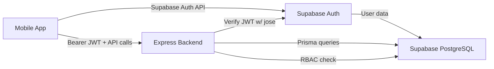

# Audit & Requirements

## Current State Audit

### Backend (`hemora-backend`)
- **Framework:** Express 5 + TypeScript + Prisma 7 + PostgreSQL
- **Auth:** Better Auth v1.7.25 with Prisma adapter, admin plugin, custom RBAC
- **Database:** Local PostgreSQL (`hemora_db`), connected via `@prisma/adapter-pg`
- **Roles:** 6 roles — DONOR, NURSE, DOCTOR, BANK_MANAGER, FACILITY_ADMIN, ADMIN
- **RBAC:** Custom access control statements in `src/lib/permissions.ts` with `requirePermission()` middleware
- **Key files:**
  - `src/lib/auth.ts` — Better Auth config
  - `src/lib/permissions.ts` — Role definitions and permission statements
  - `src/middleware/rbac.middleware.ts` — `requireAuth()` and `requirePermission()` middleware
  - `src/server.ts` — Express server, mounts Better Auth at `/api/auth/*`
  - `src/routes/prototype.routes.ts` — Protected API routes
  - `prisma/schema.prisma` — Database schema with Better Auth models (User, Session, Account, Verification)

### Mobile (`hemora-mobile`)
- **Framework:** React Native + Expo 55 + expo-router
- **Auth client:** `better-auth/react` with `expoClient` plugin (native) and custom fetch (web)
- **Session storage:** `expo-secure-store` (native), `localStorage` (web)
- **API client:** `src/lib/api.ts` — `hemoraFetch()` attaches session cookies to requests
- **Key files:**
  - `src/lib/auth-client.ts` — Better Auth client, `useSession()` hook, session caching
  - `src/lib/api.ts` — API fetch wrapper with cookie handling
  - `src/lib/permissions.ts` — Client-side role/permission definitions
  - `src/app/(auth)/sign-in.tsx` — Sign-in screen using `signIn.email()`
  - `src/app/(auth)/sign-up.tsx` — Sign-up screen
  - `src/app/(auth)/forgot-password.tsx` — Password reset
  - `src/app/_layout.tsx` — Root layout with auth guard

### Database Schema
- Tables: user, session, account, verification, facility, blood_inventory, requisition, transfusion_log, campaign, campaign_invitation
- UserRole enum has 6 values
- Better Auth manages User, Session, Account, Verification models

## Requirements

### Goals
1. Replace Better Auth with Supabase Auth for all authentication (login, signup, sessions, password reset)
2. Use Supabase JS client (`@supabase/supabase-js`) in the mobile app
3. Verify Supabase JWT tokens on the backend before authorizing requests
4. Preserve existing PostgreSQL database and Prisma schema (adapted for Supabase)
5. Merge BANK_MANAGER and FACILITY_ADMIN roles into MANAGER
6. Maintain 5-role RBAC model: DONOR, NURSE, DOCTOR, MANAGER, ADMIN
7. Keep service-role keys and database passwords exclusively on the backend
8. Preserve all existing API functionality
9. No destructive database changes

### Out of Scope
- Supabase Edge Functions
- Supabase Storage (unless already in use)
- Supabase Realtime
- Modifying the AI service (`hemora-ai`)
- Production database changes

# Technical Design

## Current Implementation

The auth flow is:
```
Mobile (Better Auth client) → Express /api/auth/* → Better Auth → Prisma → PostgreSQL
```

RBAC uses Better Auth's admin plugin with custom access control statements. The middleware (`rbac.middleware.ts`) calls `auth.api.getSession()` and `auth.api.userHasPermission()` to verify sessions and permissions.

## Key Decisions

1. **Supabase Auth for authentication only** — Supabase handles user registration, login, sessions, and JWT issuance. The backend verifies JWTs and enforces RBAC via the existing permission system (adapted).

2. **Prisma remains for data access** — Prisma continues to manage all database queries. Supabase is used as the PostgreSQL host. No migration to Supabase's direct REST API for data operations.

3. **JWT verification on backend** — The backend will verify Supabase JWT tokens (issued by Supabase Auth) using `jose` library. The `User` table in the database will be linked to Supabase's `auth.users` via the `id` field.

4. **Role storage in database** — User roles remain in the `user.role` column in the PostgreSQL database. Supabase Auth JWT will carry the `sub` (user ID), and the backend will look up the role from the database.

5. **Session persistence** — Mobile app uses `@react-native-async-storage/async-storage` for Supabase session storage as specified. Backend uses JWT verification (stateless).

6. **Role migration** — BANK_MANAGER and FACILITY_ADMIN will be merged into MANAGER via a safe SQL migration that updates existing records.

## Proposed Changes

### Phase 1: Database & Schema
- Update `prisma/schema.prisma`: Remove Better Auth models (Session, Account, Verification), replace with Supabase-compatible User model
- Update `UserRole` enum: Remove BANK_MANAGER, FACILITY_ADMIN; add MANAGER
- Create Prisma migration to merge existing BANK_MANAGER and FACILITY_ADMIN users into MANAGER
- Update `DATABASE_URL` in backend `.env` to use Supabase PostgreSQL connection string

### Phase 2: Backend Auth Replacement
- Remove Better Auth packages from `hemora-backend/package.json`
- Install `@supabase/supabase-js` and `jose` for JWT verification
- Create `src/lib/supabase.ts` — Supabase client (service role, backend-only)
- Create `src/lib/jwt-verify.ts` — JWT verification middleware
- Replace `src/middleware/rbac.middleware.ts` — Use JWT verification instead of Better Auth session API
- Update `src/server.ts` — Remove Better Auth handler, add JWT middleware
- Update `src/lib/permissions.ts` — Replace BANK_MANAGER/FACILITY_ADMIN with MANAGER
- Update `src/routes/prototype.routes.ts` — Ensure routes use new middleware

### Phase 3: Mobile Auth Replacement
- Remove Better Auth packages from `hemora-mobile/package.json`
- Install `@supabase/supabase-js` and `@react-native-async-storage/async-storage`
- Create `src/lib/supabase.ts` — Supabase client with AsyncStorage
- Replace `src/lib/auth-client.ts` — Supabase auth hooks (`useSession`, `signIn`, `signUp`, `signOut`)
- Update `src/lib/api.ts` — Attach Supabase access token as Bearer header instead of cookies
- Update auth screens (`sign-in.tsx`, `sign-up.tsx`, `forgot-password.tsx`, `reset-password.tsx`)
- Update `src/app/_layout.tsx` — Use new session hook
- Update `src/lib/permissions.ts` — Client-side role definitions
- Add `.env` variables: `EXPO_PUBLIC_SUPABASE_URL` and `EXPO_PUBLIC_SUPABASE_KEY`

### Phase 4: Dashboard Route Updates
- Update dashboard routing to use MANAGER instead of BANK_MANAGER and FACILITY_ADMIN
- Merge or redirect existing bank-manager and facility-admin dashboard routes

## Architecture Diagram



## Data Models / Contracts

### Supabase Client (Mobile)
```typescript
// hemora-mobile/src/lib/supabase.ts
import AsyncStorage from '@react-native-async-storage/async-storage'
import { createClient } from '@supabase/supabase-js'

export const supabase = createClient(
  process.env.EXPO_PUBLIC_SUPABASE_URL!,
  process.env.EXPO_PUBLIC_SUPABASE_KEY!,
  {
    auth: {
      storage: AsyncStorage,
      autoRefreshToken: true,
      persistSession: true,
      detectSessionInUrl: false,
    },
  }
)
```

### JWT Verification (Backend)
```typescript
// hemora-backend/src/lib/jwt-verify.ts
import { jwtverify } from 'jose'
import { createClient } from '@supabase/supabase-js'

// Verify JWT and return decoded payload + user from DB
export async function verifyAuthHeader(authHeader: string) {
  const token = authHeader.replace('Bearer ', '')
  const supabase = createClient(
    process.env.SUPABASE_URL!,
    process.env.SUPABASE_SERVICE_ROLE_KEY!  // service role, backend only
  )
  const { data: { user } } = await supabase.auth.admin.getUserByCookie([authHeader])
  return user
}
```

### Updated UserRole Enum
```prisma
enum UserRole {
  DONOR
  NURSE
  DOCTOR
  MANAGER
  ADMIN
}
```

### Environment Variables

**Backend (.env):**
```
SUPABASE_URL=https://fmvbkaliixhyssydseti.supabase.co
SUPABASE_SERVICE_ROLE_KEY=<secret-key-not-exposed-to-client>
DATABASE_URL=postgresql://postgres:<password>@db.fmvbkaliixhyssydseti.supabase.co:5432/postgres
```

**Mobile (.env):**
```
EXPO_PUBLIC_SUPABASE_URL=https://fmvbkaliixhyssydseti.supabase.co
EXPO_PUBLIC_SUPABASE_KEY=sb_publishable_5vkum2ZfvidIcTRygWlAZQ_yDWGFx6N
EXPO_PUBLIC_API_URL=http://192.168.43.43:5000
```

## Risks

1. **User migration:** Existing Better Auth users must be migrated to Supabase Auth. Strategy: Create a migration script that imports existing users into Supabase Auth via admin API.
2. **Session invalidation:** All existing Better Auth sessions will be invalidated. Users must re-login after migration.
3. **Role mapping:** BANK_MANAGER and FACILITY_ADMIN users must be correctly mapped to MANAGER.
4. **Supabase RLS:** If RLS is enabled on tables, it may conflict with Prisma's direct database access. **Decision: Do NOT enable RLS on tables used by Prisma.** The backend enforces RBAC via middleware.
5. **Password migration:** Better Auth stores hashed passwords. Supabase uses its own password hashing. Users may need to reset passwords, or we can use Supabase admin API to create users with emails.

# Testing

## Validation Approach

After each phase, verify that the changes work before proceeding to the next phase.

## Key Scenarios

### Authentication Flow
1. **Sign up** — New donor can register via mobile app
2. **Sign in** — Existing user can login with email/password
3. **Session persistence** — Session survives app restart (AsyncStorage)
4. **Sign out** — Session cleared, user redirected to login
5. **Password reset** — Forgot password flow works via Supabase Auth

### Role-Based Access
1. **DONOR** — Can access donor dashboard, cannot access admin functions
2. **NURSE** — Can access clinical workflows
3. **DOCTOR** — Can create requisitions, access doctor dashboard
4. **MANAGER** — Can manage inventory, campaigns, forecasting
5. **ADMIN** — Full system access, user management

### Security
1. **JWT verification** — Invalid tokens rejected by backend
2. **Expired tokens** — Expired JWTs rejected
3. **Privilege escalation** — DONOR cannot access MANAGER endpoints
4. **Service role key** — Never exposed to mobile client
5. **Cross-role access** — Each role sees only authorized data

### API Integration
1. **Inventory API** — Protected endpoints return correct data
2. **Requisition API** — Create/read/approve flows work
3. **Mobile connectivity** — Mobile app can reach backend and authenticate

## Edge Cases
- User with no role assigned (default to DONOR)
- Concurrent login from multiple devices
- Token refresh during active session
- Network failure during authentication
- Supabase Auth service unavailable

## Test Changes
- Update `hemora-backend/src/__tests__/permissions.test.ts` — Replace role names (BANK_MANAGER → MANAGER, remove FACILITY_ADMIN)
- Update `hemora-mobile/__tests__/route-mapping.test.ts` — Update dashboard routes
- Add JWT verification test for backend middleware
- Add Supabase client initialization test for mobile

# Delivery Steps

### * Step 1: Configure Supabase & migrate database schema
Set up Supabase project configuration and migrate the database schema from 6-role to 5-role model.
- Update `hemora-backend/.env` with Supabase URL, service role key, and DATABASE_URL pointing to Supabase PostgreSQL
- Update `prisma/schema.prisma`: Remove Better Auth models (Session, Account, Verification), update UserRole enum (remove BANK_MANAGER, FACILITY_ADMIN; add MANAGER)
- Create Prisma migration to merge existing BANK_MANAGER and FACILITY_ADMIN users into MANAGER role
- Run `prisma generate` to regenerate client
- Verify database connectivity with Supabase PostgreSQL
- Verify existing data is preserved after migration

###   Step 2: Replace Better Auth with Supabase Auth on backend
Remove Better Auth and implement Supabase JWT verification on the Express backend.
- Remove Better Auth packages from `hemora-backend/package.json` (`better-auth`, `@better-auth/expo`, `@better-auth/prisma-adapter`)
- Install `@supabase/supabase-js` and `jose` for JWT verification
- Create `src/lib/supabase.ts` — Supabase admin client (service role, backend-only)
- Create `src/lib/jwt-verify.ts` — Middleware to extract and verify Supabase JWT from Authorization header
- Rewrite `src/middleware/rbac.middleware.ts` — Replace Better Auth session API with JWT verification + database role lookup
- Update `src/server.ts` — Remove Better Auth node handler, keep Express routes
- Update `src/lib/permissions.ts` — Replace BANK_MANAGER and FACILITY_ADMIN with MANAGER role
- Update `src/routes/prototype.routes.ts` — Ensure all routes use updated middleware
- Update `src/__tests__/permissions.test.ts` — Fix role names
- Run backend tests to verify RBAC still works

###   Step 3: Replace Better Auth with Supabase Auth on mobile
Replace Better Auth client with Supabase JS client in the Expo mobile app.
- Remove Better Auth packages from `hemora-mobile/package.json` (`better-auth`, `@better-auth/expo`)
- Install `@supabase/supabase-js` and `@react-native-async-storage/async-storage`
- Add `EXPO_PUBLIC_SUPABASE_URL` and `EXPO_PUBLIC_SUPABASE_KEY` to `hemora-mobile/.env`
- Create `src/lib/supabase.ts` — Supabase client with AsyncStorage for session persistence
- Rewrite `src/lib/auth-client.ts` — Replace Better Auth client with Supabase auth hooks (signIn, signUp, signOut, useSession)
- Update `src/lib/api.ts` — Attach Supabase access token as Bearer header instead of cookies
- Update `src/lib/permissions.ts` — Client-side role definitions (MANAGER instead of BANK_MANAGER/FACILITY_ADMIN)
- Update auth screens: `sign-in.tsx`, `sign-up.tsx`, `forgot-password.tsx`, `reset-password.tsx`
- Update `src/app/_layout.tsx` — Use new session hook for auth guard
- Update `src/app/(auth)/staff-invitation.tsx` and `verify-email.tsx` if they use Better Auth APIs

###   Step 4: Update dashboard routes and verify complete workflow
Consolidate dashboard routes and test the complete authentication workflow end-to-end.
- Merge `bank-manager` and `facility-admin` dashboard directories into `manager` dashboard
- Update `src/app/(main)/_layout.tsx` and `_dashboard/_layout.tsx` routing to use MANAGER role
- Update all role-based route guards to check for MANAGER instead of BANK_MANAGER/FACILITY_ADMIN
- Update `hemora-mobile/__tests__/route-mapping.test.ts` with new route structure
- Test complete auth flow: sign up → sign in → session persistence → dashboard access → sign out
- Test each role independently: DONOR, NURSE, DOCTOR, MANAGER, ADMIN
- Test cross-role access restrictions
- Test JWT verification with invalid/expired tokens
- Verify backend API endpoints are protected and return correct data
- Run all backend and mobile tests