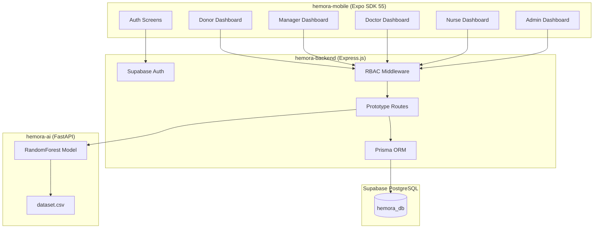

# System Architecture

## Overview

HEMORA is a three-tier application consisting of a React Native mobile frontend, an Express.js REST API backend, and a Python FastAPI AI forecasting service, all connected to a PostgreSQL database.

## Components

### hemora-mobile

The mobile application built with Expo SDK 55 and React Native.

| Aspect | Detail |
|---|---|
| **Framework** | Expo SDK 55, React Native 0.83 |
| **Language** | TypeScript |
| **Routing** | Expo Router (file-based) |
| **State Management** | TanStack Query for server state |
| **Forms** | React Hook Form + Zod validation |
| **Animations** | React Native Reanimated 4.2.1 |
| **Icons** | Lucide React Native |
| **Auth Client** | Supabase Auth client with JWT-based sessions |

**Structure:**
- `app/(main)/_dashboard/` — 5 role-specific dashboards
- `app/(auth)/` — Sign-in, sign-up, forgot password screens
- `app/_layout.tsx` — Root layout with QueryClient provider and auth state
- `components/` — Reusable UI components (EmptyState, StatCard, etc.)
- `lib/api.ts` — `hemoraFetch()` helper for authenticated API calls

### hemora-backend

The REST API built with Express.js, Supabase JWT verification, and Prisma ORM.

| Aspect | Detail |
|---|---|
| **Framework** | Express.js 5.x |
| **Language** | TypeScript |
| **Authentication** | Supabase Auth (JWT verification via JWKs) |
| **Authorization** | Custom RBAC middleware with role-based permission statements |
| **ORM** | Prisma 7.x with PostgreSQL adapter |
| **Database** | Supabase PostgreSQL |

**Structure:**
- `src/server.ts` — Entry point, middleware setup, route mounting
- `src/lib/jwt-verify.ts` — Supabase JWT verification against JWKs
- `src/lib/supabase.ts` — Supabase admin client for user lookup
- `src/lib/permissions.ts` — RBAC statement and role definitions
- `src/lib/prisma.ts` — Prisma client instance
- `src/middleware/rbac.middleware.ts` — Permission-checking middleware
- `src/routes/prototype.routes.ts` — All 20 API endpoints
- `prisma/schema.prisma` — Database schema
- `prisma/seed/seed.ts` — Demo data seed script

### hemora-ai

The AI forecasting service built with Python FastAPI and Scikit-learn.

| Aspect | Detail |
|---|---|
| **Framework** | FastAPI |
| **Language** | Python 3.9+ |
| **ML Library** | Scikit-learn (RandomForestRegressor) |
| **Data** | Pandas, NumPy |
| **Dataset** | 3,328 records of synthetic historical blood demand |

**Structure:**
- `main.py` — FastAPI app with `/predict`, `/predict/all`, `/model-info`, `/health`
- `model.py` — RandomForestRegressor training and prediction logic
- `data.py` — Dataset loading and feature engineering
- `dataset.csv` — Historical blood demand data (104 weeks × 8 groups × 4 components)
- `generate_dataset.py` — Script to generate the synthetic dataset
- `requirements.txt` — Python dependencies

## API Endpoints

All endpoints are prefixed with `/api/hemora/`.

### Authentication

| Method | Path | Description | Permission |
|---|---|---|---|
| `POST` | `/auth/sign-in` | Sign in with email/password | None (public) |
| `POST` | `/auth/sign-up` | Register a new account | None (public) |
| `GET` | `/me` | Get current user profile with invitations | Authenticated |

### Inventory

| Method | Path | Description | Permission |
|---|---|---|---|
| `GET` | `/inventory` | Get all blood inventory records | `inventory: ["read"]` |
| `POST` | `/inventory` | Create or update an inventory record | `inventory: ["update"]` |
| `PATCH` | `/inventory/:bloodGroup` | Adjust stock by delta | `inventory: ["update"]` |

### Requisitions

| Method | Path | Description | Permission |
|---|---|---|---|
| `GET` | `/requisitions` | Get all requisitions | `requisition: ["read"]` |
| `GET` | `/requisitions/my` | Get current user's requisitions | `requisition: ["read"]` |
| `POST` | `/requisitions` | Create a new requisition | `requisition: ["create"]` |
| `PATCH` | `/requisitions/:id/status` | Update requisition status | `requisition: ["approve"]` |

### Campaigns

| Method | Path | Description | Permission |
|---|---|---|---|
| `GET` | `/campaigns` | Get all campaigns with invitations | `campaign: ["read"]` |
| `POST` | `/campaigns` | Create campaign and send invitations | `campaign: ["create"]` |

### Invitations

| Method | Path | Description | Permission |
|---|---|---|---|
| `PATCH` | `/invitations/:id/respond` | Accept or decline an invitation | Authenticated (own invitation) |

### Forecast

| Method | Path | Description | Permission |
|---|---|---|---|
| `POST` | `/forecast` | Predict demand for one blood group | `forecast: ["view"]` |
| `POST` | `/forecast/all` | Predict demand for all blood groups | `forecast: ["view"]` |
| `GET` | `/forecast/model-info` | Get model performance metrics | `forecast: ["view"]` |

### Admin

| Method | Path | Description | Permission |
|---|---|---|---|
| `GET` | `/users` | List all users | `user: ["list"]` |
| `GET` | `/stats` | Get system-wide statistics | `inventory: ["read"]` |
| `GET` | `/facilities/:id/requisitions` | Get requisitions for a facility | `requisition: ["read"]` |

### Facilities

| Method | Path | Description | Permission |
|---|---|---|---|
| `GET` | `/facilities` | List all facilities with staff counts | `inventory: ["read"]` |

## Database Schema

### Key Models

**User**
- `id` (String, PK), `name`, `email` (unique), `role` (UserRole enum)
- `bloodGroup` (BloodGroup enum, optional), `phone`, `eligible`
- `facilityId` (FK → Facility), `licenseNo`
- `banned`, `banReason`, `banExpires` (Admin moderation fields)

**Facility**
- `id` (String, PK), `name`, `type` (Hospital/Blood Bank/Clinic)
- `address`, `phone`

**BloodInventory**
- `id` (String, PK), `bloodGroup` (enum), `component` (enum)
- `units` (int), `minThreshold` (int), `expiresAt` (DateTime, nullable)
- Unique constraint on `[bloodGroup, component]`

**Requisition**
- `id` (String, PK), `requesterId` (FK → User)
- `patientName`, `patientRef`, `bloodGroup`, `component`
- `unitsNeeded`, `urgency` (ROUTINE/URGENT/EMERGENCY)
- `status` (PENDING/APPROVED/DISPATCHED/REJECTED)
- `clinicalNote`, `facilityId` (FK → Facility)
- `approvedBy` (FK → User), `approvedAt`

**Campaign**
- `id` (String, PK), `title`, `description`
- `bloodGroup` (nullable), `targetUnits`
- `status` (DRAFT/ACTIVE/COMPLETED/CANCELLED)
- `startDate`, `endDate`, `createdBy` (FK → User)

**CampaignInvitation**
- `id` (String, PK), `campaignId` (FK → Campaign), `donorId` (FK → User)
- `status` (PENDING/ACCEPTED/DECLINED/EXPIRED)
- `sentAt`, `respondedAt`

### Enums

| Enum | Values |
|---|---|
| **UserRole** | DONOR, NURSE, DOCTOR, MANAGER, ADMIN |
| **BloodGroup** | A_POS, A_NEG, B_POS, B_NEG, AB_POS, AB_NEG, O_POS, O_NEG |
| **BloodComponent** | WHOLE_BLOOD, Packed_RBC, PLASMA, PLATELETS |
| **Urgency** | ROUTINE, URGENT, EMERGENCY |
| **RequisitionStatus** | PENDING, APPROVED, DISPATCHED, REJECTED |
| **CampaignStatus** | DRAFT, ACTIVE, COMPLETED, CANCELLED |
| **InvitationStatus** | PENDING, ACCEPTED, DECLINED, EXPIRED |

## RBAC Permission Matrix

| Permission | DONOR | NURSE | DOCTOR | MANAGER | ADMIN |
|---|:---:|:---:|:---:|:---:|:---:|
| `inventory: read` | ✅ | ✅ | ✅ | ✅ | ✅ |
| `inventory: update` | | | | ✅ | ✅ |
| `inventory: dispatch` | | | | ✅ | ✅ |
| `requisition: create` | | ✅ | ✅ | | ✅ |
| `requisition: read` | | ✅ | ✅ | ✅ | ✅ |
| `requisition: approve` | | | ✅ | ✅ | ✅ |
| `requisition: reject` | | | | ✅ | ✅ |
| `transfusion: create` | | ✅ | | | ✅ |
| `transfusion: read` | | ✅ | ✅ | | ✅ |
| `forecast: view` | | | | ✅ | ✅ |
| `forecast: trigger` | | | | ✅ | ✅ |
| `campaign: create` | | | | ✅ | ✅ |
| `campaign: read` | | | | ✅ | ✅ |
| `user: create` | | | | | ✅ |
| `user: list` | | | | | ✅ |
| `user: set-role` | | | | | ✅ |
| `user: ban` | | | | | ✅ |
| `user: delete` | | | | | ✅ |

## Data Flow

### Authentication Flow
1. User enters credentials on the Sign In screen.
2. Mobile app calls Supabase Auth `signInWithPassword()` to validate credentials.
3. Supabase returns a JWT token stored in the mobile app's secure storage.
4. Subsequent API requests include the JWT via the `Authorization: Bearer` header.
5. Backend verifies the JWT signature against Supabase's public JWKs.
6. Backend looks up the user in the `user` table for role and profile data.
7. If the user exists in Auth but not in the database, a minimal DB record is auto-created.
8. RBAC middleware checks the user's role and permissions for each endpoint.

### Requisition Creation Flow
1. Doctor fills the blood request form and submits.
2. Mobile app calls `POST /api/hemora/requisitions` with patient and blood details.
3. Backend creates the Requisition record with `requesterId` set to the current user.
4. The requisition appears in the bank manager's dashboard as PENDING.
5. Bank manager approves → status changes to APPROVED.
6. Bank manager dispatches → status changes to DISPATCHED, stock is deducted.

### Forecast Generation Flow
1. Bank manager dashboard loads the AI Forecasting section.
2. Mobile app calls `POST /api/hemora/forecast/all`.
3. Backend proxies the request to the AI service at `http://localhost:8000/predict/all`.
4. AI service uses the trained RandomForest model to predict demand for all 8 blood groups.
5. Backend merges predictions with current inventory data and returns deficit calculations.
6. If the AI service is offline, the backend falls back to heuristic baseline values.

### Campaign Creation Flow
1. Bank manager fills the campaign form and submits.
2. Mobile app calls `POST /api/hemora/campaigns` with title, blood group, and dates.
3. Backend creates the Campaign record.
4. Backend finds all eligible donors matching the target blood group.
5. Backend creates CampaignInvitation records for each matching donor.
6. Donors see the new invitation on their dashboard and can accept or decline.

## AI Model Details

### Model
- **Algorithm:** RandomForestRegressor (Scikit-learn)
- **Training Data:** 3,328 records (104 weeks × 8 blood groups × 4 components)
- **Features:** Blood group encoding, component encoding, week number, month, day of week, rolling averages

### Performance Metrics
- **R² Score:** 0.8033
- **MAE:** 0.8348 units
- **RMSE:** 1.0266 units

### Dataset
The synthetic dataset simulates 2 years of weekly blood demand with:
- Seasonal variation (higher demand in certain months)
- Realistic blood group frequency distribution (O+ most common, AB- rarest)
- Component breakdown (Whole Blood > RBC > Plasma > Platelets)

**Note:** The dataset is clearly labeled as demonstration data. It is not derived from real hospital records.
