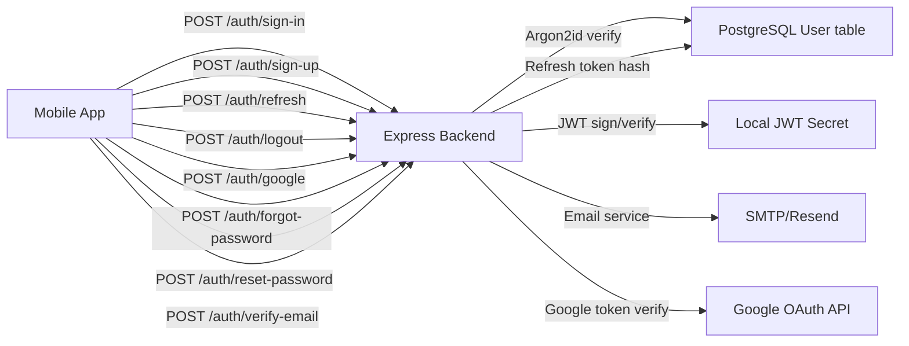

# HEMORA — Custom Authentication & Local PostgreSQL Migration Audit

## Overview

This audit documents the complete migration plan from Supabase Auth + Supabase-hosted PostgreSQL to a fully self-hosted custom authentication system with locally installed PostgreSQL. The audit covers all five phases: existing authentication audit, database audit, API audit, security design, and migration plan.

---

## 1. CURRENT ARCHITECTURE

### System Architecture

```
Mobile App (Expo/React Native) → Backend API (Express.js) → PostgreSQL (Supabase)
                                              ↓
                                      AI Service (FastAPI/Python)
```

### Current Authentication Flow

1. User enters credentials on mobile sign-in screen (`sign-in.tsx`)
2. Mobile calls `signIn()` → `supabase.auth.signInWithPassword()` (`auth-client.ts` line 98-105)
3. Supabase Auth validates credentials and returns JWT + refresh token
4. Tokens stored in Expo SecureStore via `secureStoreAdapter` (`secure-store-adapter.ts`)
5. Subsequent API requests attach JWT via `hemoraFetch()` → `getAccessToken()` (`api.ts`)
6. Backend verifies JWT signature against Supabase JWKs (`jwt-verify.ts` line 63-145)
7. Backend looks up user in Prisma `user` table for role and profile
8. Auto-creates minimal DB record if JWT valid but no DB entry exists
9. RBAC middleware checks user role against required permissions (`rbac.middleware.ts`)
10. Banned user check queries Prisma for `banned` and `banExpires` fields

### Current Components

| Component | Technology | Key Files |
|---|---|---|
| **Mobile App** | Expo SDK 55, React Native, TypeScript | `hemora-mobile/src/lib/auth-client.ts`, `supabase.ts`, `secure-store-adapter.ts`, `api.ts` |
| **Backend API** | Express.js 5, TypeScript, Prisma 7 | `hemora-backend/src/server.ts`, `prototype.routes.ts`, `rbac.middleware.ts` |
| **Database** | PostgreSQL (Supabase-hosted), Prisma ORM | `prisma/schema.prisma` — 7 models |
| **AI Service** | FastAPI, Python, Scikit-learn | `hemora-ai/main.py` — `/predict`, `/predict/all`, `/model-info`, `/health` |
| **Authentication** | Supabase Auth (JWT via JWKs) | `jwt-verify.ts`, `supabase.ts` (service role client) |

### API Endpoints (29 Total)

| Method | Path | Permission | Auth Required |
|---|---|---|---|
| GET | `/inventory` | `inventory:read` | Yes |
| POST | `/inventory` | `inventory:update` | Yes |
| PATCH | `/inventory/:bloodGroup` | `inventory:update` | Yes |
| GET | `/requisitions` | `requisition:read` | Yes |
| GET | `/requisitions/my` | `requisition:read` | Yes |
| POST | `/requisitions` | `requisition:create` | Yes |
| PATCH | `/requisitions/:id/status` | `requisition:approve` | Yes |
| POST | `/forecast` | `forecast:view` | Yes |
| POST | `/forecast/all` | `forecast:view` | Yes |
| GET | `/forecast/model-info` | `forecast:view` | Yes |
| GET | `/facilities` | `inventory:read` | Yes |
| GET | `/campaigns` | `campaign:read` | Yes |
| POST | `/campaigns` | `campaign:create` | Yes |
| GET | `/campaigns/:id` | `campaign:read` | Yes |
| GET | `/me` | any authenticated | Yes |
| GET | `/role` | any authenticated | Yes |
| GET | `/users` | `user:list` | Yes |
| POST | `/users` | `user:create` | Yes |
| POST | `/users/self` | any authenticated | Yes |
| GET | `/stats` | `inventory:read` | Yes |
| GET | `/facilities/:id/requisitions` | `requisition:read` | Yes |
| PATCH | `/invitations/:id/respond` | any authenticated | Yes |
| GET | `/notifications` | any authenticated | Yes |
| PATCH | `/notifications/:id/read` | any authenticated | Yes |
| PATCH | `/notifications/read-all` | any authenticated | Yes |
| GET | `/search` | any authenticated | Yes |
| PATCH | `/me` | any authenticated | Yes |
| POST | `/campaigns/:id/join` | any authenticated | Yes |
| PATCH | `/invitations/:id/cancel` | any authenticated | Yes |
| GET | `/notifications/unread-count` | any authenticated | Yes |
| GET | `/health` | none | No |

**Note:** The backend currently has NO authentication endpoints (no `/auth/sign-in`, `/auth/sign-up`, etc.). All authentication is handled by Supabase Auth.

### Role Permission Map (from `permissions.ts`)

| Resource/Action | DONOR | NURSE | DOCTOR | MANAGER | ADMIN |
|---|---|---|---|---|---|
| inventory:read | ✓ | ✓ | ✓ | ✓ | ✓ |
| inventory:update | | | | ✓ | ✓ |
| inventory:dispatch | | | | ✓ | ✓ |
| requisition:create | | ✓ | ✓ | | ✓ |
| requisition:read | ✓ | ✓ | ✓ | ✓ | ✓ |
| requisition:approve | | | ✓ | ✓ | ✓ |
| requisition:reject | | | | ✓ | ✓ |
| transfusion:create | | ✓ | | | ✓ |
| transfusion:read | | ✓ | ✓ | | ✓ |
| forecast:view | | | | ✓ | ✓ |
| forecast:trigger | | | | ✓ | ✓ |
| campaign:create | | | | ✓ | ✓ |
| campaign:read | ✓ | | | ✓ | ✓ |
| user:create | | | | | ✓ |
| user:list | | | | | ✓ |
| user:set-role | | | | | ✓ |
| user:ban | | | | | ✓ |
| user:delete | | | | | ✓ |

---

## 2. COMPLETE LIST OF SUPABASE DEPENDENCIES

### Backend (hemora-backend)

| File | Dependency | Description |
|---|---|---|
| `src/lib/jwt-verify.ts` | **Supabase JWKs** | Fetches `/.well-known/jwks.json` from `SUPABASE_URL` to verify JWT signatures (line 44). Validates `iss` claim against `SUPABASE_URL` (line 86). Validates `aud` claim = `"authenticated"` (line 91). |
| `src/lib/supabase.ts` | **@supabase/supabase-js** | Service-role admin client using `SUPABASE_SERVICE_ROLE_KEY`. Used for backend-only operations. |
| `src/server.ts` | **SUPABASE_URL** (env) | Referenced in server startup log message (line 70). |
| `prisma/seed/seed.ts` | **@supabase/supabase-js** | Looks up Supabase Auth user IDs via `admin.listUsers()` to match Prisma records to auth users. |
| `prisma/seed/seed-auth.ts` | **@supabase/supabase-js** | Creates test users in Supabase Auth via `admin.auth.admin.createUser()`. |
| `prisma/seed/reset-passwords.ts` | **@supabase/supabase-js** | Resets test user passwords via `admin.auth.admin.updateUserById()`. |
| `package.json` | **@supabase/supabase-js** | Runtime dependency (`^2.49.1`). |
| `package.json` | **jose** | JWT library used for Supabase JWK verification. |
| `.env` | **SUPABASE_URL** | `https://fmvbkaliixhyssydseti.supabase.co` |
| `.env` | **SUPABASE_SERVICE_ROLE_KEY** | Service role JWT for admin API access. |
| `.env` | **DATABASE_URL** | Points to Supabase-hosted PostgreSQL pooler. |

### Mobile App (hemora-mobile)

| File | Dependency | Description |
|---|---|---|
| `src/lib/supabase.ts` | **@supabase/supabase-js** | Creates Supabase client with `EXPO_PUBLIC_SUPABASE_URL` and `EXPO_PUBLIC_SUPABASE_KEY`. Configures SecureStore adapter for session persistence. |
| `src/lib/auth-client.ts` | **supabase.auth** | `signIn()` → `supabase.auth.signInWithPassword()` (line 99). `signUp()` → `supabase.auth.signUp()` (line 111). `signOut()` → `supabase.auth.signOut()` (line 129). `resetPassword()` → `supabase.auth.resetPasswordForEmail()` (line 137). `updatePassword()` → `supabase.auth.updateUser()` (line 147). `useSession()` → `supabase.auth.getSession()` + `onAuthStateChange()` (line 172-199). `refreshSession()` → `supabase.auth.refreshSession()` (line 228). `getAccessToken()` → `supabase.auth.getSession()` (line 257). |
| `src/lib/secure-store-adapter.ts` | **Supabase storage adapter** | Implements Supabase `StorageAdapter` interface using Expo SecureStore. Storage key format: `sb-<project_ref>-auth-token`. |
| `src/app/(auth)/sign-in.tsx` | **signIn, useSession** | Imports from `auth-client.ts`. Calls `signIn()` for login. Uses `useSession()` for auto-redirect. |
| `src/app/(auth)/sign-up.tsx` | **signUp** | Imports from `auth-client.ts`. Calls `signUp()` for registration. Then calls `POST /users/self` to create backend record. |
| `src/app/(auth)/forgot-password.tsx` | **resetPassword** | Imports from `auth-client.ts`. Calls `resetPassword()` to send magic link. |
| `src/app/(auth)/reset-password.tsx` | **updatePassword** | Imports from `auth-client.ts`. Calls `updatePassword()` after clicking reset link. |
| `src/app/(auth)/verify-email.tsx` | **None (placeholder)** | Resend verification email is a TODO placeholder. No actual Supabase call. |
| `src/app/_layout.tsx` | **useSession, fetchUserRole** | Uses `useSession()` for navigation guards. Fetches role from backend `/role` endpoint. |
| `src/lib/api.ts` | **getAccessToken, refreshSession** | Imports from `auth-client.ts`. Uses Supabase tokens for API requests. |
| `package.json` | **@supabase/supabase-js** | Runtime dependency (`^2.49.1`). |
| `.env` | **EXPO_PUBLIC_SUPABASE_URL** | `https://fmvbkaliixhyssydseti.supabase.co` |
| `.env` | **EXPO_PUBLIC_SUPABASE_KEY** | Publishable (anon) key for client-side auth. |

### AI Service (hemora-ai)

| File | Dependency | Description |
|---|---|---|
| `main.py` | **None** | No Supabase dependencies. Uses API key auth for backend-to-AI communication. |

### Database

| Aspect | Supabase Dependency |
|---|---|
| **Hosting** | Supabase-hosted PostgreSQL (pooler) |
| **RLS Policies** | None — no Row Level Security configured |
| **Triggers** | None — no database triggers |
| **Functions** | None — no custom database functions |
| **Extensions** | None — no Supabase-specific extensions |
| **Auth Schema** | Supabase `auth` schema manages users, sessions, and tokens separately from application data |
| **Migrations** | Standard Prisma migrations, portable to any PostgreSQL instance |

---

## 3. EXISTING AUTHENTICATION PROBLEMS DISCOVERED

### Critical Issues

1. **No backend authentication endpoints**: The Express backend has NO `/auth/sign-in`, `/auth/sign-up`, `/auth/refresh`, or `/auth/logout` endpoints. All authentication is delegated to Supabase. This means the backend cannot function independently of Supabase Auth.

2. **Password hashes not accessible**: Supabase stores password hashes in its `auth.users` table using bcrypt. These hashes cannot be exported or transferred to a custom system. All existing users will need to reset their passwords after migration.

3. **User ID coupling**: The `user.id` field in the Prisma schema is a `String` (not auto-incrementing integer), currently populated with Supabase Auth UUIDs. After migration, new users will need a different ID generation strategy (e.g., `cuid()` or UUID v4).

4. **Session management entirely in Supabase**: Refresh token rotation, session expiry, and token revocation are all managed by Supabase. None of this logic exists in the Express backend.

### Medium Issues

5. **No password reset flow in backend**: The `forgot-password.tsx` and `reset-password.tsx` screens call Supabase Auth methods directly. No backend endpoints exist for password reset token generation or validation.

6. **No email verification in backend**: The `verify-email.tsx` screen is a placeholder with a TODO. No backend endpoint exists for email verification.

7. **Google OAuth not implemented**: The task requires Google authentication independent of Supabase, but no Google OAuth flow currently exists.

8. **No refresh token endpoint**: The mobile app refreshes tokens via `supabase.auth.refreshSession()`. No backend endpoint exists for token refresh.

### Low Issues

9. **Seed scripts depend on Supabase Admin API**: `seed-auth.ts` and `reset-passwords.ts` use Supabase Admin API to create users and reset passwords. These will need to be rewritten.

10. **`supabase.ts` admin client unused in runtime**: The service-role client in `src/lib/supabase.ts` is imported but not actively used in any runtime endpoint. It's only referenced in seed scripts.

---

## 4. DATABASE MIGRATION RISKS

### Risk Assessment

| Risk | Severity | Description | Mitigation |
|---|---|---|---|
| **Data loss during export/import** | HIGH | pg_dump/pg_restore may fail for large datasets or during active writes | Schedule maintenance window; verify dump integrity with checksums |
| **Supabase UUID format mismatch** | MEDIUM | Existing user IDs are Supabase Auth UUIDs. New IDs need consistent format | Use UUID v4 for new users; preserve existing UUIDs during migration |
| **Connection string changes** | LOW | DATABASE_URL must be updated from Supabase pooler to local PostgreSQL | Update `.env` with new connection string; test connectivity before cutover |
| **Enum type compatibility** | LOW | PostgreSQL enums are schema-specific and may need recreation | Prisma migrations handle enum creation automatically |
| **Foreign key integrity** | LOW | All FK constraints are standard PostgreSQL, no Supabase-specific constraints | Verify with `\d` commands after migration |
| **Index performance** | LOW | Connection pooling differs between Supabase and local PostgreSQL | Tune `max_connections` and Prisma adapter pool settings |

### Database Schema Analysis

The existing schema is **fully portable** to local PostgreSQL:

- **No Supabase-specific features**: No RLS policies, no triggers, no custom functions, no extensions
- **Standard PostgreSQL types**: All types (TEXT, INTEGER, BOOLEAN, TIMESTAMP, enums) are standard PostgreSQL
- **Standard constraints**: Primary keys, unique constraints, foreign keys, and CHECK constraints are all standard
- **Prisma migrations**: The 3 existing migrations (`0001_init`, `0002_add_notifications`, `0003_inventory_check_constraint`) are portable SQL

### User Model — Critical Migration Target

```prisma
model User {
  id            String           @id          // Currently Supabase Auth UUID
  name          String
  email         String           @unique
  emailVerified Boolean          @default(false)
  image         String?
  createdAt     DateTime         @default(now())
  updatedAt     DateTime         @updatedAt
  role          UserRole         @default(DONOR)
  banned        Boolean          @default(false)
  banReason     String?
  banExpires    DateTime?
  bloodGroup    BloodGroup?
  phone         String?
  lastDonation  DateTime?
  eligible      Boolean          @default(true)
  facilityId    String?
  licenseNo     String?
  // ... relations
}
```

**Missing fields for custom auth:**
- `passwordHash` — Argon2id hashed password (not stored in Supabase's application schema)
- `refreshTokens` — JSON array or separate table for hashed refresh tokens
- `emailVerificationToken` — For email verification flow
- `passwordResetToken` — For password reset flow
- `passwordResetExpires` — Expiration for reset tokens

---

## 5. RECOMMENDED CUSTOM AUTHENTICATION DESIGN

### Architecture



### Authentication Endpoints (New)

| Method | Path | Description |
|---|---|---|
| POST | `/auth/sign-in` | Email/password login → returns JWT access token + refresh token |
| POST | `/auth/sign-up` | Register new account → creates User with Argon2id hash |
| POST | `/auth/refresh` | Refresh token rotation → new access token + new refresh token |
| POST | `/auth/logout` | Revoke current refresh token |
| POST | `/auth/logout-all` | Revoke all refresh tokens for user |
| POST | `/auth/google` | Google OAuth token verification → HEMORA session |
| POST | `/auth/forgot-password` | Request password reset email |
| POST | `/auth/reset-password` | Reset password with token |
| POST | `/auth/verify-email` | Verify email with token |
| POST | `/auth/resend-verification` | Resend verification email |

### Token Design

| Token | Type | Lifetime | Storage | Purpose |
|---|---|---|---|---|
| **Access Token** | JWT (HS256 or RS256) | 15 minutes | Memory (mobile app) | API authentication |
| **Refresh Token** | Random UUID/v4, hashed with Argon2id | 7 days | Database + SecureStore (mobile) | Obtain new access tokens |

### JWT Payload

```json
{
  "sub": "user-uuid",
  "email": "user@example.com",
  "role": "DONOR",
  "iat": 1234567890,
  "exp": 1234567890 + 900,
  "jti": "token-uuid-for-revocation"
}
```

### Password Policy

- Minimum 8 characters
- At least one uppercase letter
- At least one number
- Argon2id hashing with recommended parameters (memory: 64MB, iterations: 3, parallelism: 4)

### Refresh Token Rotation

1. On each refresh request, validate the submitted refresh token against the database
2. Hash the new refresh token with Argon2id and store it
3. Invalidate the old refresh token (mark as rotated)
4. Return new access token + new refresh token
5. On logout, delete the specific refresh token from the database

### Google OAuth Flow

1. Mobile app uses `expo-web-browser` to open Google OAuth consent screen
2. Google returns authorization code to redirect URI
3. Backend exchanges code for Google ID token at `oauth2.googleapis.com/token`
4. Backend verifies ID token signature and claims (iss, aud, exp, sub)
5. If user exists by Google sub or email, create HEMORA session
6. If new user, create User record with Google email and default DONOR role
7. Return HEMORA JWT access token + refresh token

### Security Controls

| Control | Implementation |
|---|---|
| **Login rate limiting** | 10 failed attempts per 15 minutes per IP/email |
| **Account enumeration protection** | Generic error messages for invalid email or password |
| **Brute-force protection** | Progressive delays after failed attempts; account lockout after 20 failures |
| **CSRF protection** | JWT in Authorization header (not cookies) |
| **XSS protection** | No sensitive data in URL parameters |
| **Secure mobile storage** | Expo SecureStore for refresh tokens; access tokens in memory only |
| **Server-side role enforcement** | RBAC middleware unchanged; roles stored in User table |
| **Token revocation** | Refresh tokens stored hashed in DB; can be individually revoked |
| **Password reset security** | Single-use tokens with 15-minute expiration |
| **Email verification** | Required for new accounts; token-based with 24-hour expiration |

---

## 6. REQUIRED FILES TO MODIFY

### Backend (hemora-backend)

| File | Action | Description |
|---|---|---|
| `src/lib/jwt-verify.ts` | **REPLACE** | Replace Supabase JWK verification with local JWT secret verification |
| `src/lib/supabase.ts` | **REMOVE** | Service-role client no longer needed |
| `src/middleware/rbac.middleware.ts` | **MODIFY** | Update to work with new JWT payload structure |
| `src/routes/auth.routes.ts` | **CREATE** | New authentication endpoints (sign-in, sign-up, refresh, logout, Google, password reset, email verification) |
| `src/lib/auth-service.ts` | **CREATE** | Password hashing (Argon2id), token generation, refresh token management |
| `src/lib/refresh-token-store.ts` | **CREATE** | Refresh token hashing, storage, rotation, and revocation |
| `src/lib/email-service.ts` | **CREATE** | Email sending for verification and password reset |
| `src/lib/google-auth.ts` | **CREATE** | Google OAuth token verification |
| `src/server.ts` | **MODIFY** | Mount auth routes; remove Supabase references |
| `prisma/schema.prisma` | **MODIFY** | Add `passwordHash`, `refreshTokens` (or separate table), `emailVerificationToken`, `passwordResetToken`, `passwordResetExpires` to User model |
| `prisma/seed/seed.ts` | **MODIFY** | Remove Supabase Auth dependency; create users with Argon2id-hashed passwords |
| `prisma/seed/seed-auth.ts` | **REMOVE** | No longer needed |
| `prisma/seed/reset-passwords.ts` | **REMOVE** | No longer needed |
| `package.json` | **MODIFY** | Add `argon2`, `nodemailer` (or `resend`), `google-auth-library`. Remove `@supabase/supabase-js`. |
| `.env` | **MODIFY** | Add `JWT_SECRET`, `JWT_REFRESH_SECRET`, `SMTP_*` or `RESEND_API_KEY`, `GOOGLE_CLIENT_ID`. Remove `SUPABASE_*`. |

### Mobile App (hemora-mobile)

| File | Action | Description |
|---|---|---|
| `src/lib/supabase.ts` | **REMOVE** | Supabase client no longer needed |
| `src/lib/auth-client.ts` | **REPLACE** | Replace all Supabase Auth calls with backend API calls |
| `src/lib/secure-store-adapter.ts` | **MODIFY** | Change from Supabase StorageAdapter to custom token storage |
| `src/lib/api.ts` | **MODIFY** | Update token refresh logic to use backend `/auth/refresh` |
| `src/app/(auth)/sign-in.tsx` | **MODIFY** | Call backend `/auth/sign-in` instead of Supabase |
| `src/app/(auth)/sign-up.tsx` | **MODIFY** | Call backend `/auth/sign-up` instead of Supabase |
| `src/app/(auth)/forgot-password.tsx` | **MODIFY** | Call backend `/auth/forgot-password` |
| `src/app/(auth)/reset-password.tsx` | **MODIFY** | Call backend `/auth/reset-password` |
| `src/app/(auth)/verify-email.tsx` | **MODIFY** | Implement actual email verification flow |
| `src/app/_layout.tsx` | **MODIFY** | Update session management for custom auth |
| `package.json` | **MODIFY** | Remove `@supabase/supabase-js` |
| `.env` | **MODIFY** | Remove `EXPO_PUBLIC_SUPABASE_*`. Keep `EXPO_PUBLIC_API_URL`. |

### Database

| Action | Description |
|---|---|
| **New migration** | Add `passwordHash`, `emailVerificationToken`, `passwordResetToken`, `passwordResetExpires` to User table |
| **New migration** | Create `RefreshToken` table (or add JSON field to User) |
| **Data migration** | Export existing data from Supabase PostgreSQL via `pg_dump` |
| **Data import** | Import to local PostgreSQL via `pg_restore` |
| **Password reset** | All existing users must reset passwords (Supabase bcrypt hashes not transferable) |

---

## 7. RECOMMENDED IMPLEMENTATION ORDER

### * Step 1: Phase 1 — Database Preparation (Prisma schema & migration)
1. Create new Prisma migration adding auth fields to User model
2. Create RefreshToken model/table
3. Test migration on local PostgreSQL

###   Step 2: Phase 2 — Backend Auth Service (core libraries)
4. Create `auth-service.ts` with Argon2id password hashing
5. Create `refresh-token-store.ts` with token rotation logic
6. Create `jwt-service.ts` for local JWT signing/verification
7. Create `auth.routes.ts` with all auth endpoints
8. Replace `jwt-verify.ts` with local JWT verification
9. Update `rbac.middleware.ts` for new JWT structure
10. Mount auth routes in `server.ts`

###   Step 3: Phase 3 — Backend Auth Endpoints (all auth routes)
11. Implement `POST /auth/sign-up` (registration with email verification)
12. Implement `POST /auth/sign-in` (email/password login)
13. Implement `POST /auth/refresh` (token rotation)
14. Implement `POST /auth/logout` (single session revocation)
15. Implement `POST /auth/logout-all` (all session revocation)
16. Implement `POST /auth/forgot-password` (password reset request)
17. Implement `POST /auth/reset-password` (password reset with token)
18. Implement `POST /auth/verify-email` (email verification)
19. Implement `POST /auth/google` (Google OAuth)

###   Step 4: Phase 4 — Mobile App Migration (auth client & screens)
20. Rewrite `auth-client.ts` to use backend API endpoints
21. Replace `supabase.ts` with custom token storage
22. Update `api.ts` token refresh logic
23. Update all auth screens to use new auth client
24. Update `_layout.tsx` session management
25. Remove `@supabase/supabase-js` dependency

###   Step 5: Phase 5 — Database Migration (local PostgreSQL)
26. Set up local PostgreSQL instance
27. Export data from Supabase via `pg_dump`
28. Import to local PostgreSQL via `pg_restore`
29. Update `DATABASE_URL` in `.env`
30. Run Prisma migrations on local database
31. Verify data integrity

###   Step 6: Phase 6 — Testing & Cleanup
32. Test all auth flows end-to-end
33. Test RBAC with new JWT structure
34. Test refresh token rotation and revocation
35. Test Google OAuth flow
36. Test password reset flow
37. Test email verification flow
38. Update seed scripts for local auth
39. Remove Supabase dependencies from package.json
40. Final integration testing

---

## 8. SECURITY RISKS AND MITIGATION

### Migration Risks

| Risk | Severity | Mitigation |
|---|---|---|
| **Password hash incompatibility** | CRITICAL | Supabase bcrypt hashes cannot be transferred. All users must reset passwords. Send password reset emails to all existing users after migration. |
| **Session disruption** | HIGH | All existing sessions will be invalidated. Plan a maintenance window. Notify users in advance. |
| **JWT secret management** | HIGH | Generate a strong random JWT secret (256-bit minimum). Store in environment variable only. Never commit to version control. |
| **Refresh token theft** | HIGH | Implement refresh token binding (store token hash, not plaintext). Use short-lived access tokens (15 min). |
| **Email service compromise** | MEDIUM | Use a reputable email service (Resend, SendGrid). Implement rate limiting on password reset requests. |
| **Google OAuth misconfiguration** | MEDIUM | Validate `iss`, `aud`, and `exp` claims. Use server-side token verification only. Never trust client-side tokens. |
| **Database connection exposure** | MEDIUM | Use environment variables for all database credentials. Never hardcode connection strings. |
| **Account takeover during migration** | HIGH | Lock all accounts during migration window. Require password reset on first login after migration. |
| **Data loss during export/import** | HIGH | Create full backup before migration. Verify checksums. Test restore on staging first. |
| **Race condition in token rotation** | MEDIUM | Use database transactions for refresh token rotation. Atomic update-and-insert pattern. |

### Post-Migration Security Checklist

- [ ] JWT secret stored in environment variable, not in code
- [ ] Argon2id parameters configured (memory: 64MB, iterations: 3, parallelism: 4)
- [ ] Refresh tokens hashed before storage
- [ ] Password reset tokens single-use with expiration
- [ ] Email verification tokens single-use with expiration
- [ ] Rate limiting on `/auth/sign-in` and `/auth/forgot-password`
- [ ] Generic error messages (no user enumeration)
- [ ] All existing users forced to reset passwords
- [ ] Supabase credentials removed from all configuration
- [ ] Database connection uses SSL/TLS
- [ ] CORS properly configured for mobile app origins
- [ ] Audit logging captures all auth events

---

## 9. EXISTING AUTHENTICATION PROBLEMS SUMMARY

| # | Problem | Severity | Location |
|---|---|---|---|
| 1 | No backend auth endpoints — all auth delegated to Supabase | CRITICAL | Entire backend |
| 2 | Password hashes not accessible — stored in Supabase auth schema | CRITICAL | Supabase `auth.users` |
| 3 | No refresh token endpoint — relies on Supabase client | HIGH | `auth-client.ts` |
| 4 | No password reset in backend — uses Supabase magic links | HIGH | `auth-client.ts`, `forgot-password.tsx` |
| 5 | No email verification in backend — placeholder only | MEDIUM | `verify-email.tsx` |
| 6 | No Google OAuth implemented | MEDIUM | Not implemented |
| 7 | User IDs coupled to Supabase Auth UUIDs | MEDIUM | `prisma/schema.prisma` |
| 8 | Seed scripts depend on Supabase Admin API | LOW | `seed-auth.ts`, `reset-passwords.ts` |
| 9 | `supabase.ts` admin client unused in runtime | LOW | `src/lib/supabase.ts` |
| 10 | Mobile app deeply coupled to Supabase Auth SDK | HIGH | All auth screens + `auth-client.ts` |

---

## 10. DEPLOYMENT ASSESSMENT

**Current State: NOT READY FOR MIGRATION — AUDIT COMPLETE, IMPLEMENTATION REQUIRED**

The migration from Supabase Auth to custom authentication is a **major architectural change** affecting:
- **13 backend files** (5 new, 5 modified, 3 removed)
- **11 mobile app files** (1 new, 7 modified, 3 removed)
- **Database schema changes** (new fields, new table)
- **All existing user sessions** (will be invalidated)
- **All existing user passwords** (must be reset)

Estimated effort: 40 implementation steps across 6 phases.

**Recommended next action:** Approve this audit and begin implementation starting with Phase 1 (Database Preparation).
